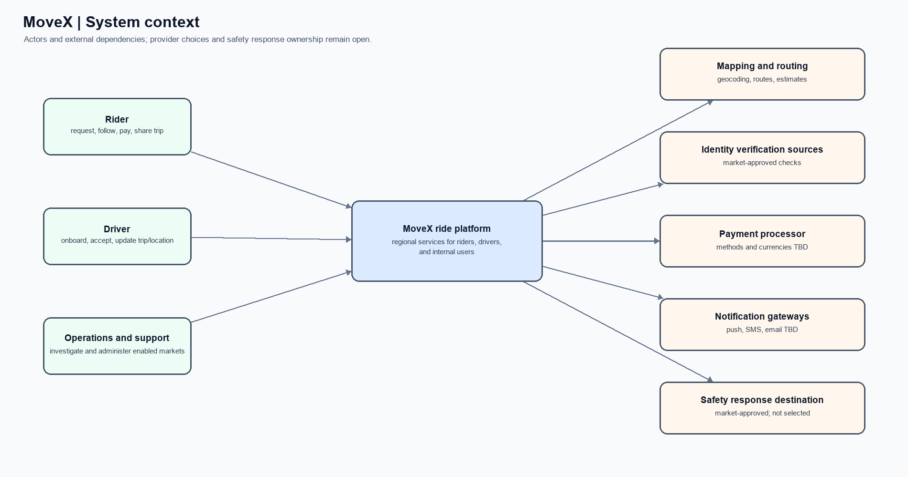
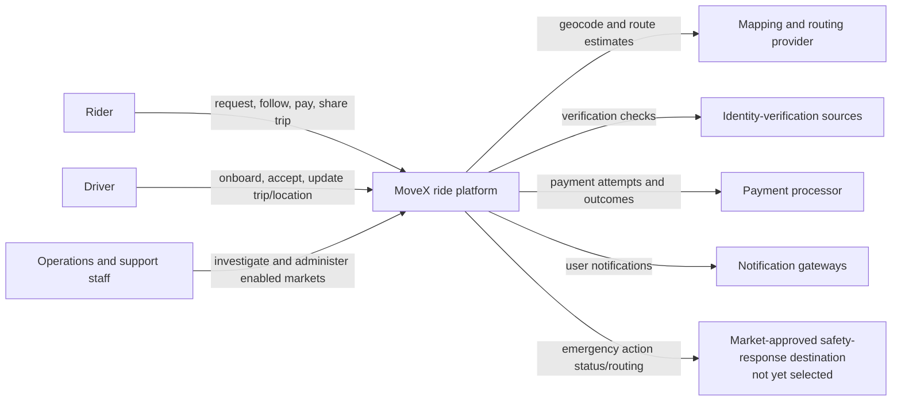

# 01 — System context

**Scope:** MoveX and its human actors/external dependencies. Internal service boundaries are intentionally hidden at this level.

The response destination is a dependency placeholder, not a claim that emergency services or a staffed response operation is available. See [the architecture overview](README.md#assumptions-and-open-decisions).
