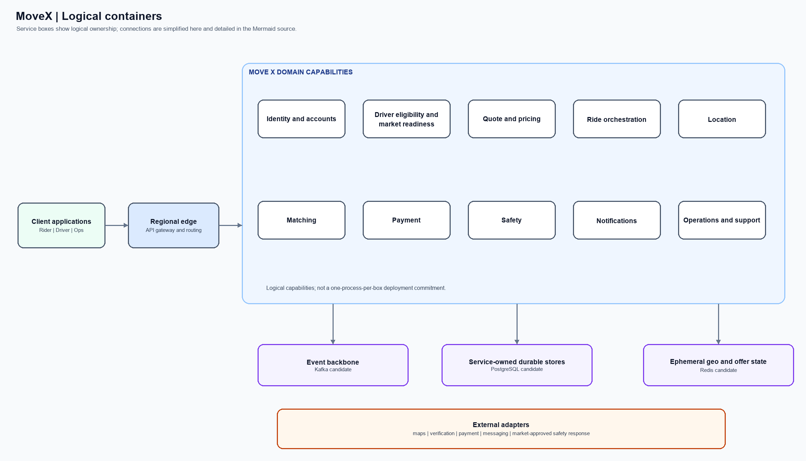
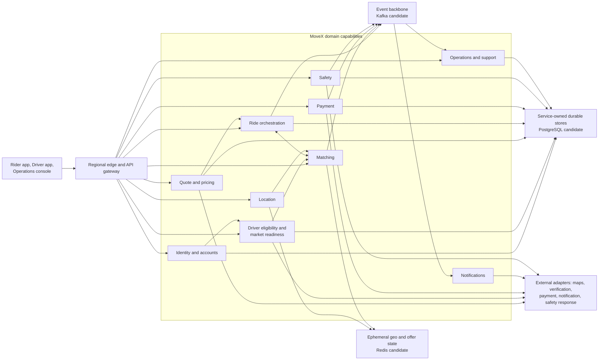

# 02 — Logical containers

**Scope:** Client applications, the MoveX service capabilities, shared communication/data roles, and external dependencies. Boxes are logical ownership boundaries, not a commitment to one process per box.

The durable-store node represents separate ownership, not a shared database. The event backbone is for lifecycle fan-out and asynchronous work; it is not the synchronous request path. Technology names are candidates only. See [the architecture overview](README.md#data-and-communication-roles).
