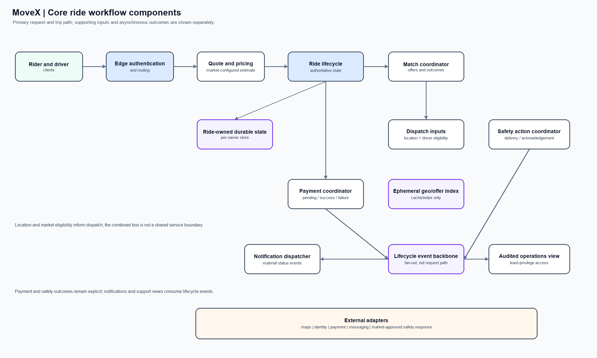
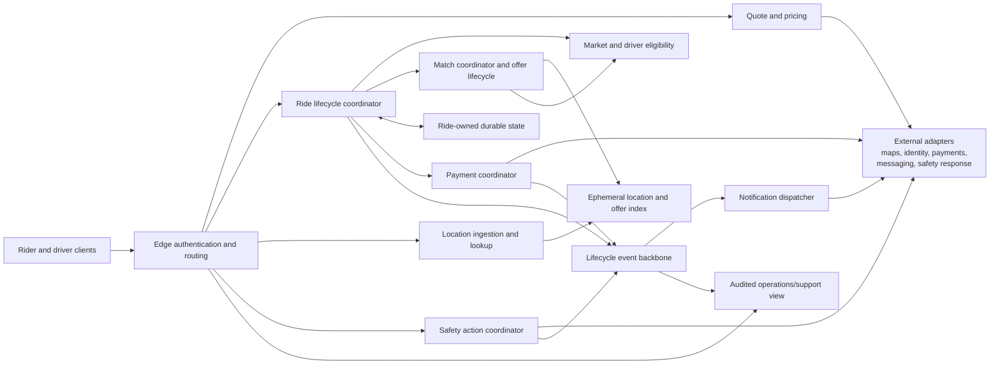

# 03 — Core ride workflow components

**Scope:** A logical decomposition of the request-to-trip-to-payment workflow and its safety/notification side effects. APIs, event schemas, database schemas, and matching algorithms are deferred.

The ride coordinator owns trip-state decisions. Matching and payment report outcomes to that lifecycle without taking ownership of the trip record. Location/offer indexes are ephemeral; durable ride and payment outcomes remain with their domain owners. See [the architecture overview](README.md#logical-service-responsibilities).
