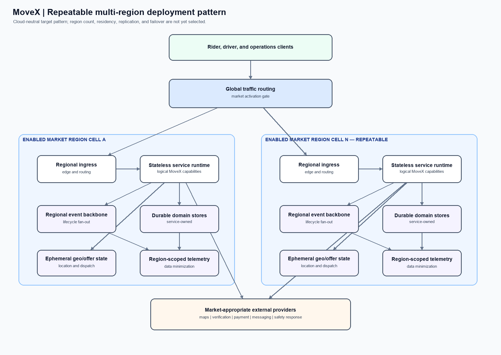
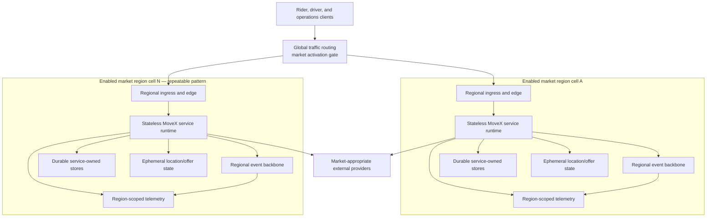

# 04 — Repeatable multi-region deployment pattern

**Scope:** A cloud-neutral logical placement pattern. Cell count, named regions, failover behavior, replication, and residency are not selected.

The cells are a repeatable pattern, not a deployment count or a guarantee of cross-region failover. The drawing intentionally does not imply cross-region replication: data placement, residency, and recovery policy require market/legal and NFR decisions. See [the architecture overview](README.md#assumptions-and-open-decisions).
